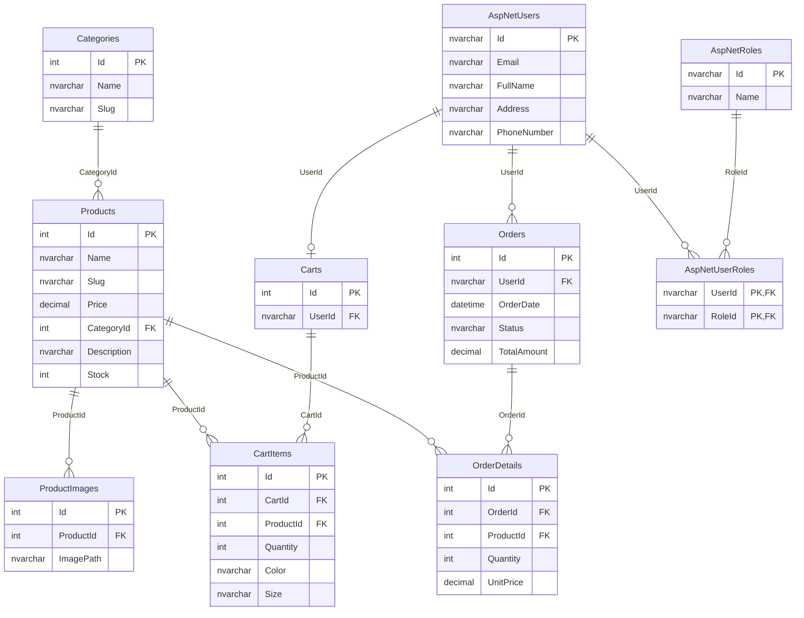

# Sơ đồ quan hệ (ERD) — Database ShopBanGiayDb

Sơ đồ sinh theo đúng khóa ngoại thực tế trong DB (truy vấn từ `sys.foreign_keys`).
Có thể dán khối Mermaid dưới đây vào https://mermaid.live để xuất ảnh PNG/SVG chèn vào báo cáo,
hoặc chụp ảnh Database Diagrams trong SSMS (xem hướng dẫn ở cuối).

## Thống kê DB (LocalDB máy phát triển)

- 14 bảng: 7 bảng nghiệp vụ (Categories, Products, ProductImages, Carts, CartItems, Orders, OrderDetails)
  + 7 bảng Identity của ASP.NET Core (AspNetUsers, AspNetRoles, AspNetUserRoles, AspNetUserClaims,
    AspNetUserLogins, AspNetUserTokens, AspNetRoleClaims)
- 14 khóa ngoại; dữ liệu mẫu: 8 danh mục, 18 sản phẩm, 144 ảnh, 2 tài khoản, 1 đơn hàng mẫu

## Tạo Database Diagrams trong SSMS (nếu cần chụp hình cho báo cáo)

1. SSMS → Connect → Server name gõ: `(localdb)\MSSQLLocalDB` → Windows Authentication → Connect
2. Mở `Databases` → `ShopBanGiayDb` → chuột phải thư mục **Database Diagrams** → **New Database Diagram**
3. Nếu SSMS hỏi cài "diagram support objects" → chọn **Yes**
4. Nếu báo lỗi *"...does not have a valid owner"* → chạy:
   `ALTER AUTHORIZATION ON DATABASE::ShopBanGiayDb TO [CORP\namhai.ng];`
5. Chọn bảng cần vẽ (khuyến nghị 7 bảng nghiệp vụ + AspNetUsers) → Add → kéo chỉnh vị trí → Ctrl+S
6. Chuột phải nền diagram → **Copy Diagram to Clipboard** để dán vào báo cáo, hoặc chuột phải
   Database Diagrams → Copy/Deliver diagram
